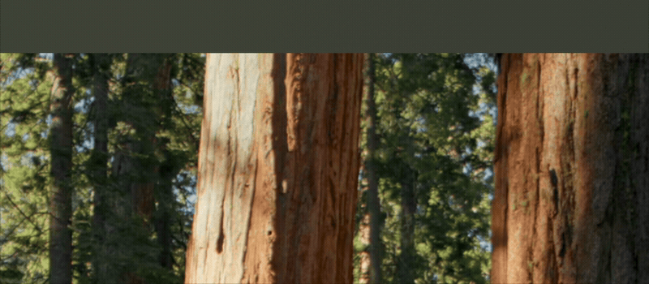

# 🎵 MusicNotch

<p align="center">
  
  
  
</p>

A minimal, ultra-clean macOS media controller living seamlessly inside and under your MacBook's hardware notch. Built natively with Swift & SwiftUI.

<p align="center">
  
</p>

---

## ✨ Features

- **Seamless Notch Integration:** Melts directly into the MacBook hardware bezel with Apple-like continuous corner radii and smooth spring physics.
- **Zero Distraction:** Stays completely silent and invisible on track changes. Expands gracefully **only** on deliberate hover.
- **Accidental-Trigger Protection:** Built-in 180ms dwell filter so swooshing across the notch (e.g. to click Safari's URL/search bar) won't trigger the island.
- **Live Album Artwork:** Automatically fetches and renders high-res covers from Spotify, Apple Music, and YouTube Music.
- **Universal Player:** Controls Spotify, Apple Music, and Safari (`music.youtube.com`) with instant responses via macOS `DistributedNotificationCenter`.
- **Pure Background Accessory:** Runs without a Dock icon or App Switcher clutter (`LSUIElement`). Never steals keyboard focus from your IDE or browser.

---

## ⚙️ Requirements & Permissions

- **Hardware:** MacBook Pro or MacBook Air with a display notch (Apple Silicon recommended).
- **macOS:** macOS 14 (Sonoma) or later.
- **Permissions:** On first launch, macOS will ask for permission to send Apple Events to Spotify/Music. Click **Allow**.
- **For YouTube Music (Safari):** 
  1. Open Safari Settings (`Cmd + ,`) → **Advanced** → check **Show features for web developers**.
  2. In the menu bar, open **Develop** → check **Allow JavaScript from Apple Events**.

---

## 🚀 Installation & Build

No bulky 15 GB Xcode IDE required — build the standalone `.app` directly from your terminal using Apple's Command Line Tools:

```bash
# 1. Clone the repository
git clone https://github.com/Hippoland99/MusicNotch.git
cd MusicNotch

# 2. Compile Release Binary
mkdir -p MusicNotch.app/Contents/MacOS
swiftc -parse-as-library -O *.swift -o MusicNotch.app/Contents/MacOS/MusicNotch
codesign --force --deep --sign - MusicNotch.app

# 3. Move to Applications & Launch
cp -r MusicNotch.app /Applications/
open /Applications/MusicNotch.app
```

---

## 🔄 Launch at Login (Optional)

To start MusicNotch automatically on system boot:

```bash
osascript -e 'tell application "System Events" to make login item at end with properties {path:"/Applications/MusicNotch.app", hidden:false, name:"Music Notch"}'
```

---

## 📄 License

Distributed under the MIT License. See [LICENSE](LICENSE) for more information.

Copyright © 2026 Hippoland99
